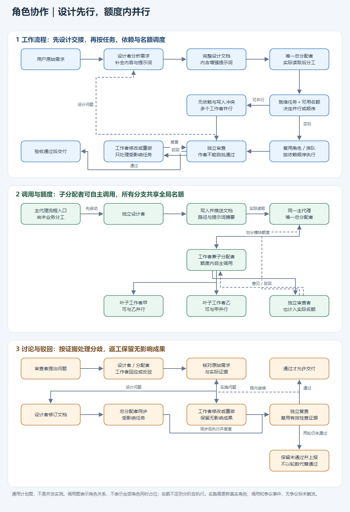

# 角色协作工作流

通过设计者、总分配者、工作者和独立审查者协作完成任务，支持在共享名额内分层拆分、并行执行与审查返工。

- [技能入口](.agents/skills/role-team/SKILL.md)
- [设计文档](角色协作Skill_设计文档.md)
- [流程图渲染脚本](.agents/skills/role-team/scripts/render-flowcharts.cjs)



## 渲染流程图

运行下面的命令生成 SVG；末尾添加 PNG 路径可同时导出 PNG：

```sh
node .agents/skills/role-team/scripts/render-flowcharts.cjs input.json output.svg [output.png]
```

SVG 无需安装额外依赖。PNG 需要宿主已有的 Playwright 和浏览器，可通过 PLAYWRIGHT_MODULE_PATH 和 EDGE_EXECUTABLE_PATH 指定路径。

示例输入见 [设计流程图.json](流程图/设计流程图.json) 和 [renderer-smoke.json](流程图/renderer-smoke.json)。
