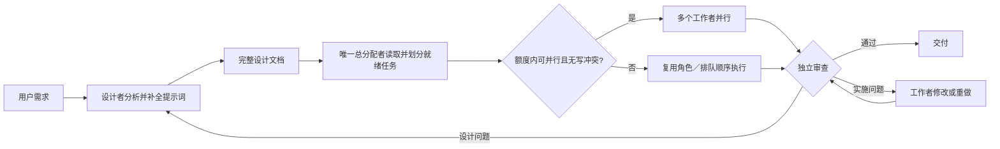
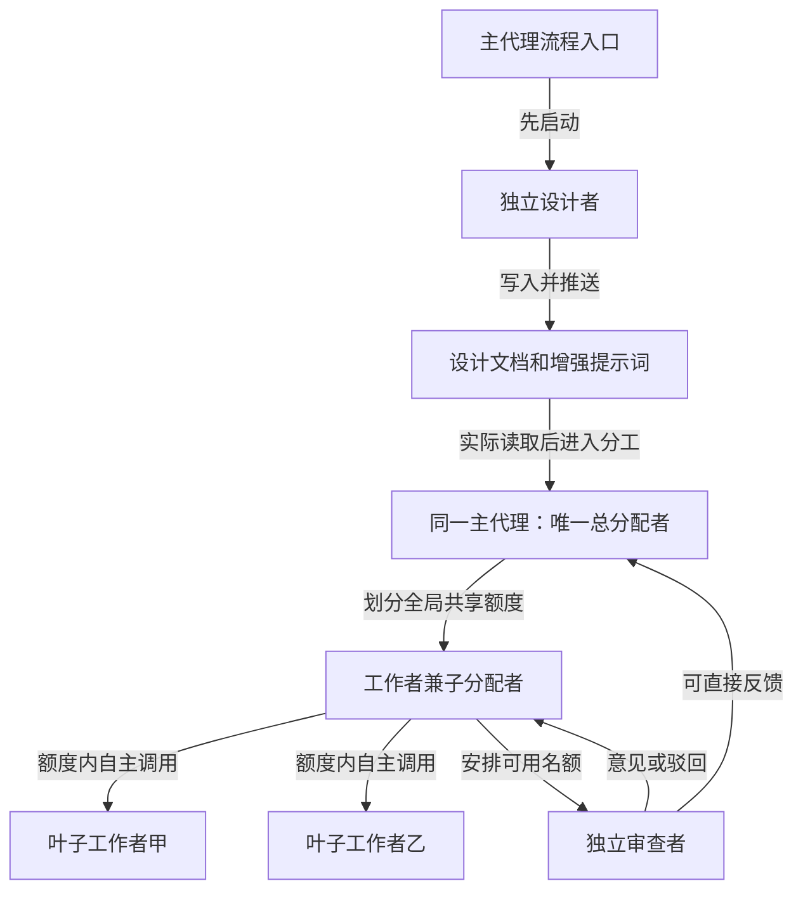
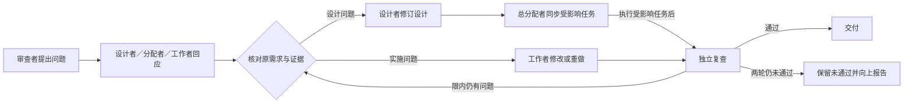
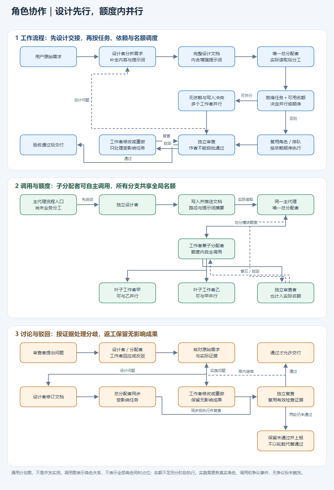

# 角色协作 Skill：设计文档

更新：2026-11-19  
工作目录：当前项目根目录  
状态：已落实并行优先、自主子分配、全局共享名额与按任务确定人数；保留前置设计者和独立审查。本文描述通用工作流。

## 1. 角色与顺序

**用户需求 → 设计者 → 完整设计文档与增强提示词 → 唯一总分配者 → 子分配／工作 → 独立审查 → 交付或返工。**

| 角色 | 数量与关系 | 职责 |
| --- | --- | --- |
| 设计者 | 默认1个，先于业务分工 | 分析原始问题和需求，补全必要上下文与任务提示词，形成完整设计文档，推送给总分配者 |
| 总分配者 | 全任务仅1个 | 读取设计文档和增强提示词，落实任务分工、调用其他角色、处理分歧并汇总交付 |
| 工作者／子分配者 | 可多个 | 任务清晰就执行；仍复杂时临时作为子分配者继续细分、调用叶子工作者并组织审查 |
| 审查者 | 每项交付有独立审查责任 | 依据用户要求检查实际成果，可直接向设计者、子分配者或总分配者提意见，可驳回并要求修改或重做 |

子分配者仍属于工作者，不是第二个总分配者。作者不能兼任自己成果的独立审查者。设计者负责形成设计，不直接派发实施工作。

## 2. 设计者必须交付什么

完整设计文档应包含以下内容，深度随任务规模调整；简单任务也要覆盖关键信息，不为完整而写成长篇。

1. **问题与目标**：忠实记录原始诉求、要解决的问题与期望结果。
2. **需求与边界**：区分用户明确要求、合理假设、待澄清信息和可选扩展；明确本轮做什么。
3. **方案与内容补全**：完善必要的背景、方法、步骤、接口或内容结构，说明关键取舍。
4. **模块与交付物**：将方案整理为可继续分工的模块，说明输入、输出、依赖、可并行的任务组和共享文件的归属建议；具体人数由总分配者结合宿主容量决定。
5. **验收标准**：给出可检查的完成条件与关键质量要求。
6. **三类简图**：工作流程、调用／交接流程、讨论与驳回流程；标明当前是计划图。
7. **给总分配者的增强提示词**：整理成可直接执行的任务简报，包含目标、约束、交付物、验收标准和分工建议；保留原始诉求，不用扩写内容替换用户本意。

优先使用用户指定的设计文件；否则在本次任务输出目录保存一份 `设计文档.md`。增强提示词放在文档末尾即可，不强制再生成第二份文件。避免覆盖不属于本任务的既有文档。

扩充必须服务于用户目标。可选扩展只作建议，不能自动变成必须实施的工作，也不能编造事实、数据或不存在的工具能力。

## 3. 如何前置与交接

主代理先作为流程入口启动独立设计者，提供用户原始问题、已有资料和约束；**设计交接完成前不开始业务分工或实施**。

设计者写入文档后，向主代理推送真实文件路径、关键假设与增强提示词摘要。主代理实际读取文档，核对需求和验收标准后，才进入唯一总分配者的分工阶段。流程入口与总分配者是同一个主代理的前后阶段，并非新增第二个总分配者。

默认交接后继续执行；只有用户明确要求先审方案，或缺少会改变方向的决定性信息时，才停在相应位置等待用户。能合理假设的内容标注后继续，不反复要求确认。

设计者完成交接后可以结束当前执行回合，后续需要修订时再调用；结束、空闲或等待是否释放名额，以宿主实际状态为准。总分配者不能忽略设计文档直接凭摘要派发工作。

## 4. 三类设计流程图

以下是设计示意。每次真实运行仍须用实际角色和事件更新流程图，不能把计划当成已执行。

### 工作流程图



### 调用与文档交接图



### 讨论与驳回图





必须提供可查看的 SVG／PNG 兼容图，不能只给文字或图源码。开始展示计划，执行变化时更新，交付展示实际过程；无争议或驳回时如实标记“未触发”。

## 5. 并行调度与工作者数量

### 5.1 先划任务，再定人数

总分配者按可交付、可验收的任务组分工，不按职业名称固定凑人数。任务已就绪、互不依赖、没有写入冲突且值得拆分时，优先并行；有前后依赖、共同修改同一文件或任务很小时，顺序执行或交给同一负责人。共享文件由明确的负责人整合。

先把就绪任务交给合适且仍持有名额的空闲角色。需要重新占位的唤醒与新建角色一起进入下式，获得名额后才派发对应任务：

```text
新增／重新占位的工作者数 = max(0, min(
  复用后仍就绪且未分派的任务组数,
  本分配者已获额度内的可用名额,
  宿主实际可新增的名额,
  工作者上限余量（仅用户设置上限时参与）
))
```

根层使用全局未分配的额度，子层使用本模块未占用且未另行预留的额度；给下级或审查者预留的名额不可再用于新增工作者。用户若设置工作者上限，按同时占位的工作者计算，包含子分配者。

人数随依赖解除、任务完成和额度变化调整，不为每个小步骤创建新角色。任务总数、累计角色数、同时占用名额数分别记录，不能混用。空闲角色若仍持有名额，可以直接复用；若唤醒需要重新占位，也须计入公式。

### 5.2 一个全局额度，允许范围内自主子分配

- 总分配者维护全局名额记录；设计者、总分配者、子分配者、叶子工作者和审查者都按宿主规则计入。不能把每个子分配者都当成拥有一套新的全局额度。
- 总分配者可把额度划给模块，**模块额度包含子分配者自身、全部后代和模块审查者**。子分配者在额度内自主创建下级代理、交流和组织审查，不逐次请求用户确认；需要增加额度时向上请求，额度不足则排队。
- 名额只计一次：全局名额处于未分配、已预留或已占用之一。子模块额度从父模块额度中划出，不能重复计入全局总额；预留转为已创建只改变状态。创建前先登记归属，创建失败归还额度；调整或收回未使用额度须同步原持有者，确认后再重新分配。
- 角色结束、空闲、等待或调用超时，均不自动代表名额已释放。依据宿主真实状态更新；创建结果不明时先核对已有角色，避免重试创建同一任务。

例如宿主总容量为4，主代理与子分配者各实际占1个时，其余角色合计最多占2个，不能每个分支再各开4个。审查者也需要名额；工作者结束后能否用于审查，要看宿主是否确实释放。

### 5.3 避免空转层级与互相等待

只有模块仍含多个值得独立处理的任务时才继续子分配；任务清晰就直接执行。拆分前确认至少有一条能执行并完成独立审查的路径，避免名额全被管理者和等待者占满。

容量不足时，复用合适角色、减少层级、收回未用额度或分阶段顺序执行。无需始终空留一个审查席位，但在占满名额前必须确认独立审查如何调度；宿主不释放已完成会话或释放机制不明时，提前安排审查者的额度，不能用作者自审代替。

这里的并行指真实子代理会话可同时执行，实际并发受宿主控制，不承诺操作系统多线程。工作者自主创建的是任务内部子代理，不自动为用户创建侧边栏中的新聊天；全部调用仍受原任务范围和权限约束。

### 5.4 一份记录支持恢复，已有证据按需复用

在本次任务的 `流程记录.md` 维护简表，不另建调度服务：

| 任务ID | 负责人／实例ID | 依赖 | 状态 | 交付物／检查证据 | 名额归属与占用 |
| --- | --- | --- | --- | --- | --- |
| 实际任务 | 实际角色或待分配 | 前置任务或无 | 待执行／执行中／待审查／需修改／已通过／受阻 | 真实路径或结果 | 所属模块及预留／占用／已释放 |

表旁简记全局容量和各模块额度。各级分配者在派发前登记自身任务和占额状态，变化通过消息报给总分配者；**共享的 `流程记录.md` 只由总分配者写入**，子分配者不并行修改该文件。中断恢复时先核对角色、文件和任务状态，只继续未完成及受影响工作，不重新创建整队。

工作者自检并提供证据，审查者独立判断并核对关键风险。各级分配者复用同一版本已有的有效检查结果，避免重复全量验证；成果、输入或要求改变，证据不足或出现新问题时，再做相关检查。复用证据不能代替独立审查。

## 6. 执行、讨论与审查

- 总分配者根据设计派发任务，讲清“做什么、负责哪部分、交付什么、由谁审查”。工作者可在范围内继续拆分，直到任务清晰可执行。
- 使用真实子代理与消息交流，按第5节调度并行工作；层级不等于同时运行数量。模型与思考强度继续继承默认配置。
- 各角色可提问、反驳或请求已有队友协助。审查者可直接向各级分配者反馈，不需作者批准。
- 驳回要有具体不满足项、证据与返工要求；问题成立则修改或重做并独立复查。分配者不能将仍成立的驳回直接改成通过。
- 设计缺陷退回设计者修订，总分配者同步受影响任务；实施缺陷退回工作者。不能通过降低验收标准掩盖实施失败。
- 同一争议默认最多两轮回应；同一问题两轮修改仍不通过时，向上报告未通过与下一步，不无限循环，也不把讨论结束当作验收通过。
- 最终交付包含设计文档、实际成果、审查结论、重要异议与三类实际简图。所有扩充与角色调用仍在用户原任务的授权范围内。

## 7. 实现位置与范围

入口：`.agents/skills/role-team/SKILL.md`。通用绘图工具：`scripts/render-flowcharts.cjs`。

保留通用 skill、本文及流程图；先前小游戏工程、受控样本、运行记录、截图和效率对比报告已移除。本轮同步更新 skill 执行规则与设计图，并进行格式和一致性检查；不新建示例工程或调度程序，也不把文档检查声称为并发运行实测。

参考 [Superpowers 的独立实施与审查](https://github.com/obra/superpowers/blob/main/skills/subagent-driven-development/SKILL.md) 和 [skill-orchestrate 的独立意见与协调](https://github.com/darrenoakey/skill-orchestrate/blob/main/SKILL.md)；设计者前置与交接规则以本文为准。
